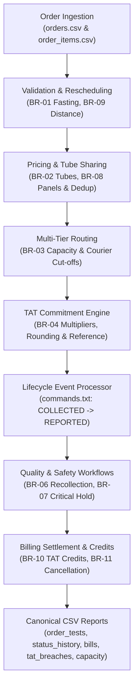
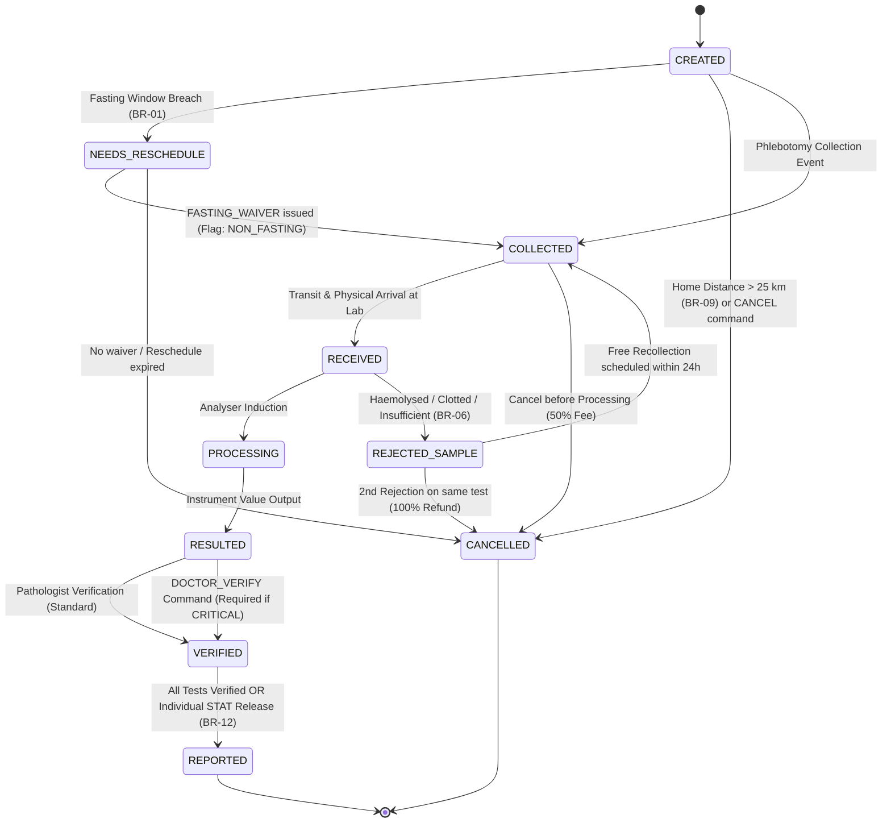

# PS-062 · Diagnostic Lab Test Ordering and Report TAT Engine
## Architecture, Business Rules Specification & Viva Defense Guide

---

## 1. Executive Summary

PS-062 is an enterprise back-end engine engineered for diagnostic laboratory chains. It coordinates multi-tier laboratory test ordering, sample requirement validation, biological fasting windows, dynamic multi-tier routing with daily capacity overflow management, Turnaround-Time (TAT) commitments, phlebotomist scheduling, life-cycle event state transitions, and billing with delayed-report credits.

The system is command-file driven, deterministic, and fully compliant with laboratory quality assurance standards.

---

## 2. Business Rules Register

| Rule ID | Rule Title | Operational Definition |
|---|---|---|
| **BR-01** | Fasting Window Validation & Waiver | If any ordered test requires fasting of $N$ hours, the collection slot must be at least $N$ hours after the patient's stated last-meal time ($\text{slot\_start} \ge \text{last\_meal\_ts} + N$). The longest fasting requirement among ordered tests governs. A breach places the order in `NEEDS_RESCHEDULE` unless the patient issues a `FASTING_WAIVER` command. If waived, affected tests are flagged `NON_FASTING`, and the order is exempt from delayed-report credits. |
| **BR-02** | Tube Sharing & Collection Optimization | Tests sharing the same sample type and tube type share a single collection tube. Each physical tube holds at most 4 tests. The order's tube count governs tube collection fees: Rs 50 per tube beyond the second ($\max(0, T - 2) \times 50$). |
| **BR-03** | Multi-Tier Lab Routing & Daily Capacity Overflow | A test is processed at the lowest-tier lab that performs it with remaining daily capacity for that sample type. If the local collection lab lacks capacity or cannot run the tier/sample type, the test is couriered to the next tier (`LAB-03` for L2, `LAB-04` for REFERENCE). If local capacity is exhausted, the routing reason is `CAPACITY_OVERFLOW` and tracked under `overflow_routed`. |
| **BR-04** | Promised TAT Computation & Ceil Rounding | Standard TAT is scaled by priority: ROUTINE ($1.0\times$), URGENT ($0.5\times$), STAT ($0.25\times$), with a 2-hour minimum. The clock starts at `COLLECTED`. REFERENCE-tier tests receive $+24$ hours courier transit allowance. Promised report time rounds up to the next whole hour. |
| **BR-05** | Operating Hours & 24x7 STAT Intake | Processing occurs exclusively within lab operating hours. The TAT clock runs continuously across nights. Samples received outside operating hours are stamped `RECEIVED` at next opening time. Exception: STAT samples are accepted 24x7 at L1 collection labs. |
| **BR-06** | Sample Rejection & Double-Rejection Refund | Haemolysed, clotted, or insufficient samples trigger `REJECTED_SAMPLE`. A free recollection is scheduled within 24 hours; the TAT clock restarts from the new collection timestamp. A second rejection on the same order cancels the affected test with a 100% refund, releasing remaining verified tests as a partial report. |
| **BR-07** | Critical Value Hold & Doctor Verification | A result outside the test's critical reference range (`critical_low`, `critical_high`) flags the record as `CRITICAL`. Standard pathologist verification is held; the test moves to `VERIFIED` only upon a `DOCTOR_VERIFY` command. The report must be released within 1 hour of verification; exceeding 1 hour triggers a `CRITICAL` breach. |
| **BR-08** | Pricing, Panel Bundling & Priority Surcharge | Panel bundled price applies if all member tests are ordered. If a panel and one of its member tests are both ordered, the duplicate test is removed from billing and not charged. Overlapping panels charge both panel prices, but shared tests are executed once in the laboratory. Surcharges: URGENT $+50\%$, STAT $+100\%$ on test/panel base price. |
| **BR-09** | Home Collection Banding & Distance Caps | Distance is measured as straight-line Haversine ($R = 6371.0$ km) rounded to 2 decimal places. Bands: $\le 10$ km: Rs 200 flat; $10\text{ km} < d \le 25\text{ km}$: Rs 400 flat; $> 25$ km: Not offered (order rejected/cancelled). Home collection fee is waived if billable order value $\ge \text{Rs } 2,000$. Phlebotomists work 30-minute slots, max 8 visits/day, and max 10 km between consecutive visits. |
| **BR-10** | Delayed-Report Credits & Waiver Exemptions | If actual `REPORTED` timestamp exceeds promised time by $> 2$ hours ($> 120$ min), credit 10% of that test's price; if $> 24$ hours ($> 1440$ min), credit 50%. Credits are capped at test price. Credits are not issued if delay was caused by patient-side recollection or a waived fasting breach. |
| **BR-11** | Tiered Order Cancellation Policy | Cancellation before `COLLECTED` is free (100% refund). After `COLLECTED` and before `PROCESSING`, a 50% cancellation fee is charged (50% refunded). After `PROCESSING`, no refund (100% charged). Panel cancellation is all-or-nothing. |
| **BR-12** | Synchronized Report Release & STAT Release | An order report is released to the patient only when every test in the order is `VERIFIED`. Exception: Any STAT test is released individually immediately upon verification. A partial report is also released when a test is cancelled due to double rejection. |
| **BR-13** | Patient Delta-Check Engine *(Stretch Goal)* | Evaluates incoming numeric results against the patient's previous historical result for the same analyte. Variances exceeding $30\%$ flag `DELTA_CHECK_ALERT` for laboratory re-run. |
| **BR-14** | Batch-based Analyser Scheduling *(Stretch Goal)* | Automatic analyzer queues batch runs when 10 samples accumulate in the pending queue OR 2 hours elapse since the oldest pending sample arrived. |

---

## 3. State Machine & Lifecycle Transitions

---

## 4. Algorithmic Formulations

### 4.1. Fasting Requirement (BR-01)
Let $\mathcal{T}_{\text{order}}$ be the set of unique tests in an order.
$$N = \max_{t \in \mathcal{T}_{\text{order}}} (\text{fasting\_hours}(t))$$
$$\text{Valid} \iff \text{slot\_start} \ge \text{last\_meal\_ts} + N \text{ hours}$$

### 4.2. Tube Optimization & Fee (BR-02)
For each unique combination of $(\text{sample\_type}, \text{tube\_type})$ with test count $k$:
$$\text{tubes}(s, \tau) = \left\lceil \frac{k}{4} \right\rceil$$
$$T = \sum_{(s, \tau)} \text{tubes}(s, \tau)$$
$$\text{tube\_fee} = \begin{cases} 0.00 & \text{if } T \le 2 \\ (T - 2) \times 50.00 & \text{if } T > 2 \end{cases}$$

### 4.3. Promised Turnaround Time (BR-04)
Let $T_{\text{std}}$ be the test's standard TAT in hours, and $M_p \in \{1.0, 0.5, 0.25\}$ for ROUTINE, URGENT, STAT respectively:
$$T_{\text{eff}} = \max\left(2.0, T_{\text{std}} \times M_p\right) + (24.0 \text{ if REFERENCE else } 0.0)$$
$$\text{raw\_promised} = \text{collected\_ts} + T_{\text{eff}} \text{ hours}$$
$$\text{promised\_ts} = \text{ceil\_hour}(\text{raw\_promised})$$

### 4.4. Haversine Distance (BR-09)
With Earth radius $R = 6371.0$ km:
$$\Delta\phi = \text{lat}_2 - \text{lat}_1, \quad \Delta\lambda = \text{lon}_2 - \text{lon}_1$$
$$a = \sin^2\left(\frac{\Delta\phi}{2}\right) + \cos(\phi_1)\cos(\phi_2)\sin^2\left(\frac{\Delta\lambda}{2}\right)$$
$$c = 2 \operatorname{atan2}\left(\sqrt{a}, \sqrt{1 - a}\right), \quad d = \operatorname{round}(R \cdot c, 2)$$

### 4.5. Financial Settlement Formula (BR-08, BR-10, BR-11)
$$\begin{aligned}
\text{net\_amount} = &\; \text{tests\_amount} + \text{panels\_amount} - \text{duplicate\_removed} \\
&+ \text{priority\_surcharge} + \text{tube\_fee} + \text{home\_collection\_fee} \\
&+ \text{cancellation\_charge} - \text{delay\_credit} - \text{refund}
\end{aligned}$$

---

## 5. Planted Edge Cases & Verification Trace

| Scenario ID | Test Case & Order | Business Rule | Planted Value / Condition | Verified Outcome |
|---|---|---|---|---|
| **EC-01** | `ORD-0007` | BR-01 | Lipid Profile needs 12h fasting; meal at 20:30, slot at 08:30 (exactly 12h). | Valid fasting window ($\ge 12$h); order proceeds directly to collection. |
| **EC-02** | `ORD-0009` | BR-02 | 5 SST tests (needs 2 tubes) + 1 EDTA test (1 tube) = 3 tubes. | Total tubes = 3; tube fee charged = $(3 - 2) \times 50 = \text{Rs } 50.00$. |
| **EC-03** | `ORD-0028` | BR-03 | Walk-in collected at 16:00:00 (exact LAB-01 $\to$ LAB-03 cut-off). | Departs on same day's 16:30 courier; arrives LAB-03 at 17:20:00. |
| **EC-04** | `ORD-0043` | BR-04 | STAT Troponin I (std TAT 4h) collected at 02:14:00 at L1 LAB-01. | $4 \times 0.25 = 1$h raised to 2h min; 04:14 rounds up to 05:00:00. |
| **EC-05** | `ORD-0060` | BR-05 | Reaches LAB-02 at 20:59:00 (1 min before 21:00 close). | Received immediately at 20:59:00; processing resumes next morning. |
| **EC-06** | `ORD-0057` | BR-08 | KFT Panel + Potassium (member) + Electrolytes Panel. | Potassium duplicate removed (-Rs 180); shared tests run once. |
| **EC-07** | `ORD-0073` | BR-09 | Home collection distance 10.00 km; order value Rs 2,000.00. | Within 10 km band (Rs 200); waived because value $\ge \text{Rs } 2,000$. |
| **EC-08** | `ORD-0086` | BR-10 | Promised 16:00:00, Reported 18:00:00 (exactly 2 hours delay). | Not $> 2$ hours ($> 120$ min); credit pct = 0.0%, credit amt = Rs 0.00. |
| **Trap 1** | `ORD-0024` | BR-03 | Collected 16:01:00 (1 min after courier cut-off). | Departs next day (16:30); TAT clock continues to run without extension. |
| **Trap 2** | `ORD-0045` | BR-01, BR-10 | Fasting breach waived by patient. | FBS flagged `NON_FASTING`; order marked exempt from delay credits. |
| **Trap 3** | `ORD-0048` | BR-01 | Fasting gap 7h for 10h FBS test without waiver. | Order set to `NEEDS_RESCHEDULE`; no lifecycle events proceed. |
| **Trap 4** | `ORD-0018` | BR-06, BR-12 | Potassium rejected twice (haemolysed). | Potassium cancelled with Rs 180 refund; CBC released as partial report. |
| **Trap 5** | `ORD-0113` | BR-07 | Serum Potassium 6.8 (critical high 6.2); Dr verify at 12:40. | Reported at 13:41 (61 min after verify) $\to$ `CRITICAL` breach. |
| **Trap 6** | `ORD-0089` | BR-09 | Home address beyond 25 km limit. | Order rejected at intake; tests set to `CANCELLED`; bill = Rs 0.00. |
| **Trap 7** | `ORD-0110` | BR-03 | 5th Urine sample collected at LAB-02 on 2026-10-13 (cap = 4). | 5th sample overflows to LAB-03; recorded as `CAPACITY_OVERFLOW`. |
| **Trap 8** | `ORD-0118` | BR-11 | Thyroid panel cancelled after collected, before processing. | 50% charge (Rs 275), 50% refund (Rs 275); net payable = Rs 425.00. |

---

## 6. Viva Voce Defense Guide

### Question 1: How do fasting, routing, and operating-hours rules together determine the promised time?
**Answer:**
1. **Fasting Requirement (BR-01):** The fasting window determines whether the order is eligible to be collected at the scheduled slot. If the patient has not fasted for at least the required hours $N$, the order is placed on `NEEDS_RESCHEDULE` and no collection can occur unless waived. If waived, collection proceeds at the scheduled slot.
2. **TAT Clock Anchor & Routing (BR-03, BR-04):** The TAT clock starts strictly at the physical `COLLECTED` timestamp. Routing determines whether the test is processed locally or must travel to a higher-tier lab:
   - For tests routed to `REFERENCE` tier labs (`LAB-04`), an additional 24 hours of courier allowance is added to the commitment ($T_{\text{eff}} = \max(2.0, T_{\text{std}} \times M_p) + 24.0$).
   - For tests routed to L2 (`LAB-03`), the courier cutoff determines when physical transit occurs; however, per BR-03, missing the courier cutoff does **not** push back the promised TAT—the TAT clock continues to run against the original commitment.
3. **Operating Hours (BR-05):** The laboratory only performs diagnostic processing during operating hours (e.g., 07:00–21:00 for L1). Samples arriving outside operating hours are stamped `RECEIVED` at the next morning's opening time (unless STAT at a 24x7 L1 lab). However, the promised TAT clock is an absolute wall-clock commitment that runs continuously through the night.
4. **Hour Rounding (BR-04):** The sum of the collection timestamp and the effective TAT is rounded up to the next whole hour ($\text{ceil\_hour}$), producing the immutable promised report timestamp.

### Question 2: Why does STAT change the report release rule?
**Answer:**
Under standard clinical operations (BR-12), diagnostic reports are released to patients and referring physicians in whole-panel bundles. An order is held until **every** ordered test is verified so that the treating clinician receives an integrated clinical picture (e.g., checking Sodium and Potassium together before prescribing intravenous fluids).

However, **STAT orders represent immediate, life-threatening clinical emergencies** (e.g., suspected acute myocardial infarction or critical hyperkalemia). Under BR-12:
- Holding a STAT Troponin or Blood Gas result while waiting for a routine CBC or Liver Function Test would jeopardize patient survival.
- Therefore, any test ordered as STAT bypasses the whole-order release barrier and is released individually to the clinician immediately upon verification.
- In addition, STAT samples are granted 24x7 intake privileges at L1 laboratories regardless of closing hours (BR-05), undergo priority analyzer queuing, and have their turnaround times compressed to $0.25\times$ with a strict 2-hour minimum.

### Question 3: How does the system prevent double-counting and revenue loss when panels overlap?
**Answer:**
Under BR-08, when two panels share common analytes (e.g., Kidney Function Test and Electrolytes both containing Sodium and Potassium), the patient is charged both bundled panel prices because panels are commercially contracted diagnostic packages. However, from a laboratory operations perspective, patient biological samples should not be drawn multiple times or analyzed twice for the exact same analyte. The engine performs set union deduplication on the member test codes, running the physical assay exactly once on the analyzer, preventing unnecessary reagent waste while preserving commercial contract terms. Furthermore, if an individual test is ordered alongside a panel that already contains it, the standalone test charge is completely removed from the bill (`duplicate_removed`).

---

## 7. Stretch Goals Implementation

### 7.1. BR-13: Patient Delta-Check Engine
Implemented in `engine/stretch.py`:
- Tracks a longitudinal history of previous numeric results indexed by `(patient_name, test_code)`.
- Upon instrument result ingestion, calculates percentage difference:
  $$\Delta\% = \frac{|\text{current} - \text{previous}|}{\text{previous}} \times 100\%$$
- If $\Delta\% > 30.0\%$, the test record is stamped with `DELTA_CHECK_ALERT` and flagged for pathologist re-run.

### 7.2. BR-14: Batch-based Analyser Scheduling
Implemented in `engine/stretch.py`:
- Simulates automated clinical chemistry and hematology analyzers.
- Manages an in-memory queue per `(lab_id, sample_type)`.
- Triggers batch execution whenever:
  1. Queue depth reaches 10 samples (`CAPACITY_REACHED (10)`), or
  2. 2 hours elapse since the oldest sample in the queue was received (`TIMEOUT (2h)`).
- Produces verifiable execution timelines and queue utilization metrics.
